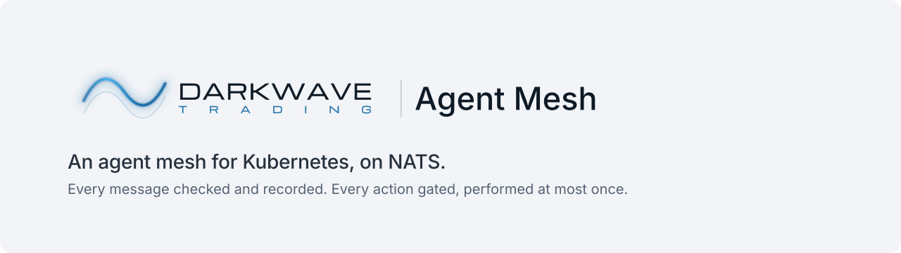
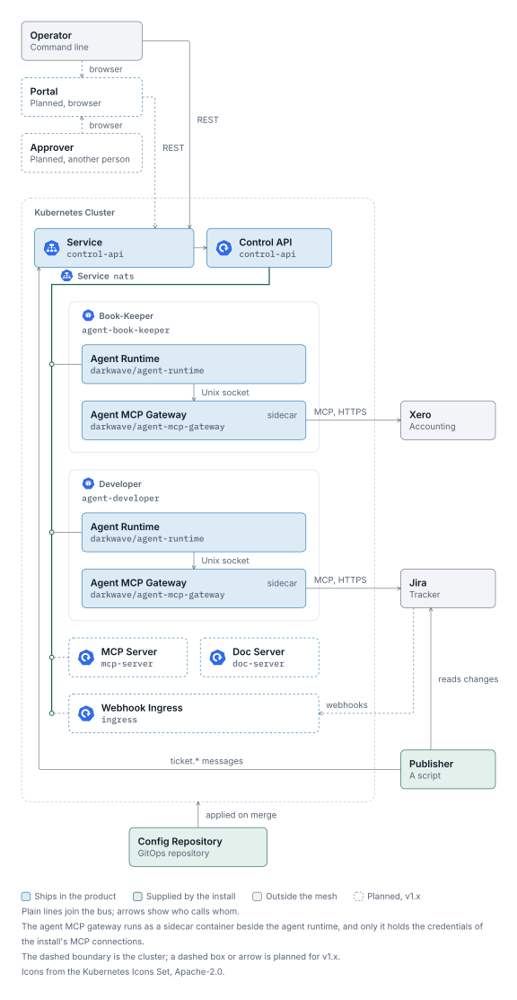
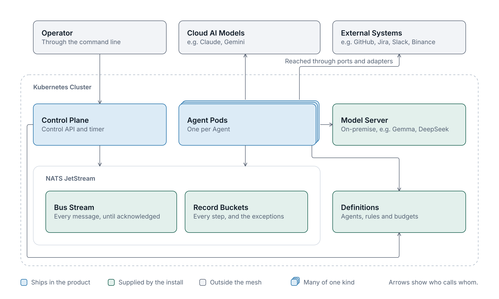
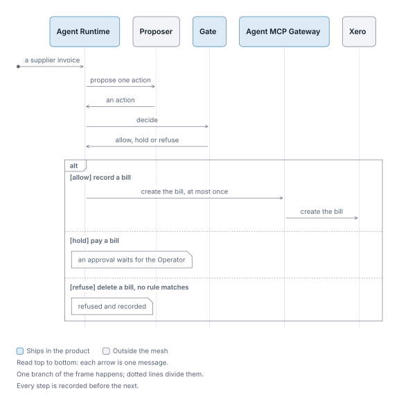
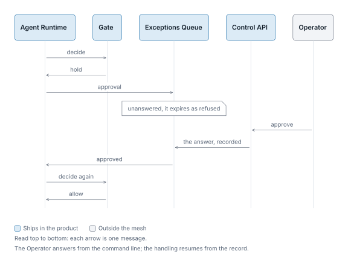
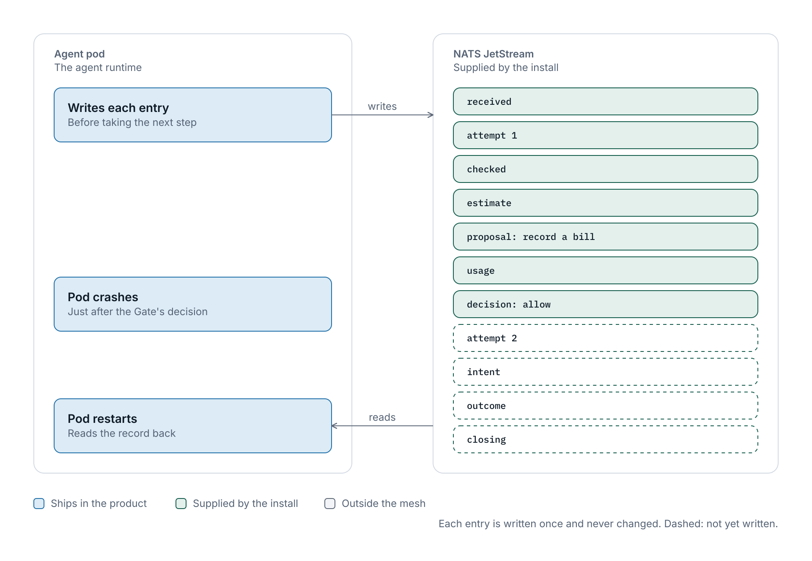

<!-- markdownlint-disable MD033 MD041 -->
<picture>
  <source media="(prefers-color-scheme: dark)" srcset=".github/assets/agent-mesh-hero-dark.svg">
  
</picture>
<!-- markdownlint-enable MD033 MD041 -->

# Darkwave Agent Mesh

An agent mesh for Kubernetes, on NATS.

The Agent Mesh runs AI agents on Kubernetes. Each Agent is declared in a Markdown file: the messages it handles, the model, script or person that proposes its actions, and the actions it may take. An action not listed is refused; one marked `hold` waits for a person. Every step is recorded before the next is taken, and no action is performed twice on the Agent Mesh's own initiative.

Coming soon

## What it is

An **Agent** handles messages and acts on them. It is declared in Markdown, together with its rules, and listens to **subjects**, dotted names such as `invoice.received` that messages are sent to. The **Operator** is the one person who runs an install (not a Kubernetes operator).

Each Agent has one **proposer**, which proposes one action for each message. A proposer is a model, in the cloud or served in the cluster; a script, plain code for work that needs no model; or the Operator, who is asked and answers from the command line. The Operator also has an Agent of their own, the one whose proposer is a person.

The **agent runtime** is the process that runs an Agent in its own pod. It checks the message, asks the proposer for one action, passes that action through the **Gate**, records every step, and performs the action at most once on the Agent Mesh's own initiative. The Gate applies the Agent's rules to the action, for the Agent and for the Principal the message acts for (Identity, below). The mesh is the Agents, the bus that joins them, the runtime, Gate and record around each, and the control plane that starts and stops them (How it works, below); nothing else is shared.

### A minimal Agent

```markdown
# Book-Keeper

Records supplier bills in Xero.

Listens to: invoice.received
Proposer: claude-sonnet-5-5
Budget: 2,000 messages and USD 20 a month

## Rules

| Action              | Effect |
|---------------------|--------|
| xero.create-invoice | allow  |
| xero.create-payment | hold   |
```

The Book-Keeper reaches Xero through the `xero` action gateway, the adapter that performs its actions against Xero, which the install supplies, here one that calls the Xero MCP server. The server's tools are the actions the rules can name: the Book-Keeper may create an invoice, a supplier bill included, and paying one waits for the Operator. Every other Xero tool, updating an invoice included, is refused, because no rule lists it. An effect is one of three, fixed in the Agent Mesh: `allow`, `hold` or `refuse`. A rule can also be limited to a subject and to the Principals it applies for; left out, as here, it applies to every subject the Agent listens to and every Principal. That is close to the least an Agent needs; the definition template shows the rest.

## Design

What v1.0 is designed to do:

- **Definitions.** Agents, their rules, budgets and schedules are plain text files under version control. The **definitions** are those files at one merged revision; a timer fires the schedules.
- **The record.** One Agent's work on one message is a **handling**. Each step of a handling is written to the record as an entry, in order, before the next step is taken, and the closing entry ends it (Durability, below).
- **Input.** Every input is checked against its written contract where it enters: shape, size and encoding, not meaning. Input that fails the check is refused and recorded, never repaired. A well-formed hostile instruction passes the check, which is why there is a Gate.
- **Identity.** Every message carries two proved identities, both **Principals**: its sender's, and the one the work acts for, which is whoever started the chain of messages the work is. Each is proved where the message enters, by the connection for an Agent's own messages and by the control API, the service the command line calls, for a person's or a program's, and never read from the payload. How a person or a program proves itself to the control API is being designed and is published with v1.0. The Gate decides for the Principal the work acts for. A program at the command line runs under its own Principal, and the control API accepts an Operator-only command from the Operator's own identity alone.
- **The Gate.** No action is performed unless a rule allows it, or holds it and the Operator approves and the Gate allows it again.
- **At most once.** The Agent Mesh never performs one handling's action twice on its own initiative. A message sent again under the same sender and id is handled once by each Agent that listens for it.
- **Idempotence.** Every write has a key, and a repeat under the same key changes nothing: a publish by its sender and message id; a handling by the message and the Agent; each entry of a handling, written as a claim that one writer wins; the intent by its handling, performed only by the holder of its lease; an answer by its exception id; a retry by the problem it answers; a scheduled message by its schedule, version and fire time; a reload by its revision. A gateway passes the action id to the outside system as its idempotency key where the system takes one; where it does not, at most once rests on the lease and on the gateway answering nothing when unsure.
- **The agent runtime.** One process per Agent. It starts the Agent's handlings one at a time, in the subject's order, while other Agents run in parallel; a handling that waits on the Operator is parked and the next one starts, so actions are not always performed in that order. On start, including after a crash, and on each tick of its own clock, it reads the record for handlings with no closing entry and carries each one on from its last entry, before any new message, except one that waits on the Operator. A handling resumed before its outcome counts an attempt, and at the Agent's attempt limit it stops and the Operator is asked. Stopping an Agent lets an action under way finish; its messages wait until it starts again.
- **Budgets.** Before a proposer is asked, the cost of the handling is estimated and checked against the Agent's budget for the period, a count of messages and a cost. The actual cost is recorded afterwards and can exceed the estimate. Once the budget is reached, the Agent's new messages are refused until the period ends, and the Operator is told once; spending can pass the budget by the overruns of handlings already under way.
- **Specification.** The message path is specified in TLA+, a language for specifying systems, and model-checked within its model's stated limits; v1.0 runs the checks in CI. A scenario suite, scripted from the specification's sequences, runs against the code. Each guarantee has an ID; a proof map names the TLA+ property, test suite or stated assumption behind it, and its limits, and a test that checks it carries the same ID where there is one.
- **Ports.** Models, the bus, the record store, the rule rows, telemetry and secrets plug in at **ports**: interfaces the core, the message path and the Gate, defines and an adapter implements. Outside systems are reached through action gateways, adapters the install supplies. Secrets are read by adapters only, never by the core. One conformance kit tests every adapter of a port against the same contract.
- **Configuration, as GitOps.** Three kinds, three paths. Settings, what a process connects to and how it runs, come from environment variables only: one named variable per setting, listed by `--help`, read once at start, and a missing or invalid value refuses the start. Secrets come by a mounted file through the secrets port; the variable names the path, never the value. Definitions, what the Agents may do, live in a repository of the install's own, where every change to what an Agent may do is a reviewed pull request: `dwmesh definitions check` checks them offline before merge, and only the Operator's reload puts a revision in force, recording its version. The template repository, `darkwave-agent-mesh-config`, holds the layout: `definitions/`, `deploy/` as kustomize, the mesh version it configures, and the check in CI. A merge applies what a revision's Agents need to run, through `kubectl apply -k` or Flux or Argo CD; only the Operator's reload then puts its rules in force, so the order is always apply, then reload. NATS comes by its own chart.
- **Latency.** The time the agent runtime's own path may take is written down as a latency budget, and v1.0's code is benchmarked against it.

What it is not: a workflow engine, since no flow is defined and none is driven; a store, since it holds nothing beyond the record and the exceptions queue (The Operator, below); a model host, since it ships no model and reaches every model through an adapter and every outside system through a gateway; or a service mesh, whose proxies see traffic between services but cannot keep an action to at most once.

Instead of a defined flow, work that takes several steps is a chain of messages: an Agent's action sends a message, another Agent handles it, and the Principal the work acts for travels with every message in the chain. No Agent waits on another, so a cycle of requests cannot deadlock, and a chain that never ends is ended by the budgets of the Agents in it. Each link is a handling, with its own check, Gate decision and record. What a flow engine gives and this does not is a join: an Agent that must act only once several answers are in keeps that state itself.

## How it works

The Operator works from the command line, which calls the control API from outside the cluster; the control API and the timer, which fires schedules and expiries, are the control plane, inside it. Each Agent is run by its own agent runtime, in its own pod, and NATS JetStream connects them; the control plane joins the same bus. The core is the message path and the Gate; everything else plugs in at a port.

<!-- markdownlint-disable MD033 -->
<picture>
  <source media="(prefers-color-scheme: dark)" srcset=".github/assets/agent-mesh-figure-dark.svg">
  
</picture>

<picture>
  <source media="(prefers-color-scheme: dark)" srcset=".github/assets/agent-mesh-schematic-dark.svg">
  
</picture>
<!-- markdownlint-enable MD033 -->

The Agents shown are examples; the Trading Assistant and the Risk Monitor only read and report. Every message an Agent handles takes these steps in order, as far as it gets, and each step it takes is recorded.

1. **Received.** The agent runtime takes the message from a sender whose identity has been proved, records it once, and counts the attempt against the Agent's attempt limit. The same message id from the same sender with different content is refused and recorded apart.
2. **Checked.** The agent runtime checks the message against its contract. A message that fails the check is refused, never repaired.
3. **Estimated.** The agent runtime estimates what handling the message will cost and checks the estimate against the Agent's budget. If it would take the Agent over its budget, the message is refused.
4. **Proposed.** The Agent's proposer, a model, a script or the Operator, proposes one action. If the proposer refuses instead, the message is refused.
5. **Gated.** The Gate applies the Agent's rules to the proposed action, for the Agent and for the Principal the message acts for. The most restrictive matching rule decides: allow, hold for the Operator, or refuse; if no rule matches, the action is refused. An approved hold is decided again before anything is performed.
6. **Intended.** Before acting, the agent runtime claims the intent in the record, with a lease longer than the gateway's timeout. Only the attempt that wins that claim performs; one that finds it already there never does.
7. **Performed.** The agent runtime performs the action, at most once, through the gateway the install supplies for that kind of action, and records the outcome: succeeded, or failed. If the gateway gives no answer, nothing is recorded, the action is never performed again on the Agent Mesh's own initiative, and the Operator is asked what happened.
8. **Closed.** The agent runtime writes the closing entry last, and the handling is over.

A refusal at any step is recorded and ends the handling. Some refusals also raise a problem for the Operator.

### The Gate

The Gate is plain code in the core. It reads the proposed action, the Agent's rules, the message's subject and the Principal the message acts for, which come from the record and no payload can change. It never reads the message's content. Whatever a misled proposer proposes, the most it gets is what the rules allow that Agent for that Principal; within an allowed kind of action, the proposer still chooses the target. The Gate does not make an allowed action right, which is why the Book-Keeper above holds paying a bill for the Operator and allows only recording one. The same proposed action, for the same Agent, on the same subject, on behalf of the same Principal, under the same definitions and the same approval, always gets the same decision, and an error refuses. The rules are rows the Gate reads through a port, and every rule-row adapter is tested for the same behaviour.

<!-- markdownlint-disable MD033 -->
<picture>
  <source media="(prefers-color-scheme: dark)" srcset=".github/assets/agent-mesh-gate-dark.svg">
  
</picture>
<!-- markdownlint-enable MD033 -->

### The Operator

Whatever only a person can decide reaches the Operator through one **exceptions queue**, and only the handling that asked pauses; everything else runs on, except an Agent over its budget, whose new messages are refused until the period ends. There are three kinds: an **approval**, when the Gate holds an action; a **problem**, when something went wrong, such as an action whose outcome is unknown; and a **proposal asked**, when the Operator's own Agent is asked to propose. The Operator answers from the command line: approve or refuse, acknowledge, resolve or retry, or propose. Each answer is written to the record like any other entry, the first answer in time wins, and the handling that asked resumes from the record, or for a retry a new message starts. An approval or a proposal asked that is left unanswered expires as refused. The Operator's own Agent has no hold rules: what a person proposes is allowed or refused, never approved by the same person.

<!-- markdownlint-disable MD033 -->
<picture>
  <source media="(prefers-color-scheme: dark)" srcset=".github/assets/agent-mesh-operator-dark.svg">
  
</picture>
<!-- markdownlint-enable MD033 -->

### Durability

Every step of a handling is recorded, in order, in a record store that outlives the Agent's pod; v1.0 ships an adapter for NATS JetStream. The entries follow the steps: the message received and the attempt, the check, the estimate, the proposal and its cost, the Gate's decision, the intent, the outcome and its cost, and the closing entry. The record is made durable before the proposer is asked and again before any action is performed, provided the store makes a write durable before acknowledging it; for JetStream that means sync on every write and, where there is more than one server, replicas in separate failure domains. Before that first durable point a message is only as safe as the bus holds it. From its first durable point a handling is never lost: if a pod crashes, the agent runtime reads the record back on restart, counts a new attempt, and carries on from the first entry not yet written. The one exception is an intent with no outcome: that action is never performed again, and the Operator is asked what happened. Each entry is written once and never changed: a second writer finds the entry already there and stops. With the intent's lease, and no retry after no answer, that is what keeps an action to one performance across crashes and restarts. The record is append-only and keeps every entry, message content included; v1.0 deletes and rotates nothing, so an install sizes the store for that and decides what may enter a message. Each process writes under its own identity and may write only its own handlings' keys; the server itself refuses deletes and rewrites; connections use mutual TLS; encryption at rest is the volume's.

<!-- markdownlint-disable MD033 -->
<picture>
  <source media="(prefers-color-scheme: dark)" srcset=".github/assets/agent-mesh-record-dark.svg">
  
</picture>
<!-- markdownlint-enable MD033 -->

## The command line

The Operator works from `dwmesh`, a client of the control API, and later of the doc server, which lets Agents search a folder of Markdown, with one subcommand per operation and no logic of its own. Its nouns are the Agent Mesh's own terms. Every command that changes something confirms first. A program runs under its own Principal and is refused every Operator-only command. Output is plain text, or JSON with `--json`. Command names may change before v1.0.

```text
dwmesh definitions check definitions/            # offline, in the config repository's CI: every rule names an action a gateway offers
dwmesh agent list                                # every Agent, its state and its budget this period
dwmesh agent start book-keeper                   # Operator only; its open handlings resume first
dwmesh exception list --kind approval            # what is waiting on the Operator
dwmesh exception approve 7f3a                    # Operator only; the Gate decides the action again
dwmesh exception resolve 2c19 --outcome failed   # Operator only; states what an unknown action did
dwmesh message trigger invoice.received --id inv-42 --content - --yes < invoice.json
                                                 # a script publishes a message under its own identity
dwmesh message trace --agent book-keeper <trace id>   # one handling's entries, in order; a trace id is the sender and the message id
dwmesh handling list --open --agent book-keeper  # handlings with no closing entry
dwmesh costs --period 2026-10                    # estimated and actual cost, against each Agent's budget
dwmesh health                                    # the bus, the record store, and each Agent's last entry and open handlings
```

After v1.0, the doc server adds `dwmesh doc search`, which returns what an Agent's own search would.

## Extending it

There are three ways: one is a file, two are adapters, built into a release.

- **Add an Agent**: one Markdown file, as above. It takes effect at the next reload of the definitions.
- **Connect a system**: an action gateway, the adapter that performs one kind of action against an outside system. Its actions become the ones rules can name. A gateway passes the action id on where the system takes one, times out before the intent's lease runs out, and answers succeeded, failed only when the action certainly did not happen, or nothing when unsure; the at-most-once guarantee rests on that contract, and the conformance kit tests it.
- **Swap a part**: a model provider, the bus, the record store, the rule rows, telemetry or secrets, each an adapter of a port, which passes the conformance kit before it is trusted.

Nothing in the core changes for any of the three.

## What v1.0 holds

- The message path, specified in TLA+ and model-checked in CI, with the scenario suite and the proof map
- The Gate, with rule rows as its first adapter
- The exceptions queue: approvals, problems and proposals asked, answered by the Operator
- Agents, rules, budgets and schedules declared in Markdown, with a definition template and an example Agent
- The agent runtime: one process per Agent, in its own pod on Kubernetes, with recovery from the record and an attempt limit
- A REST control API and the command line, `dwmesh`, with authentication
- The config repository template, `darkwave-agent-mesh-config`, with the offline definitions check in its CI
- One model provider adapter, for a model in the cloud or served in the cluster; a script proposer; and the Operator as proposer
- Bus and record store adapters on NATS JetStream
- Telemetry through a port, Prometheus by default, and secrets read by adapters only
- An adapter conformance kit and a benchmark harness

v1.0 is built from source. After v1.0: a web portal, a webhook ingress, an MCP server, a doc server that lets Agents search a folder of Markdown, checking of the runtime's own recorded traces against its specification, a Helm chart and published container images.

## Who builds it

Darkwave Trading Limited, a proprietary trading firm in New Zealand. Darkwave Trading builds the Agent Mesh to run its own agentic business.

## Built With

The agent runtime, the control API and `dwmesh` are written in Rust, as static binaries with no runtime beneath them.

<!-- markdownlint-disable MD033 -->
<picture>
  <source media="(prefers-color-scheme: dark)" srcset=".github/assets/rust-logo-dark.svg">
  
</picture>
<!-- markdownlint-enable MD033 -->

## Contributing

Contributions are not taken before v1.0. How they are taken from then on is in `CONTRIBUTING.md`, published with it; GitHub receives releases, and nothing is merged there.

## Licence

Releases from v1.0 are licensed under the Apache License 2.0. Until v1.0, no licence is granted beyond GitHub's Terms of Service.

---

Xero and Claude are trademarks of their owners; the Agent Mesh is not affiliated with or endorsed by them. The Rust logo is a trademark of the Rust Foundation, shown under CC BY 4.0 to say what the Agent Mesh is written in; the Rust project endorses nothing here.

© 2026 Darkwave Trading Limited
